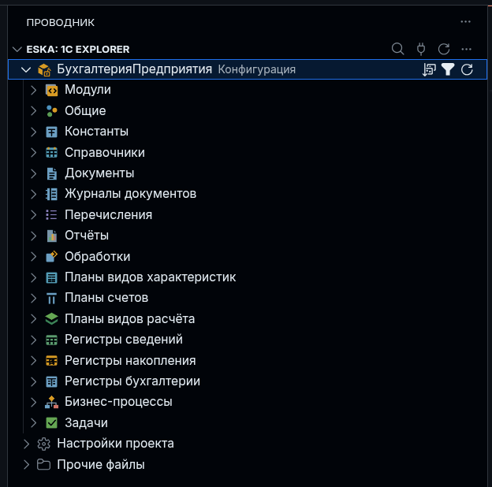

# ESKA: 1C Explorer

[](https://open-vsx.org/extension/1c-tooling/eska-explorer)
[](https://open-vsx.org/extension/1c-tooling/eska-explorer)

**Метаданные 1С, свойства объектов и BSL в VS Code и VSCodium.**

Explorer работает с выгрузкой **Designer XML** через самостоятельный
[`eska-project`](https://github.com/1c-tooling/eska). Поддерживает конфигурации,
расширения, внешние обработки и отчёты. Языковые функции выполняет внешний
[`bsl-analyzer-app`](https://github.com/itrous/bsl-analyzer), а дерево и запись
свойств работают независимо от него.

[Общее пошаговое руководство](https://github.com/1c-tooling/eska/blob/main/docs/user-guide.md) ·
[Руководство по дереву](docs/usage.md) ·
[Установка компонентов](docs/component-setup.md) ·
[Сайт](https://1c-tooling.github.io/eska/docs/)

## Возможности

Дерево повторяет структуру Конфигуратора: модули, общие объекты, справочники,
документы, регистры и другие виды метаданных. Ветки загружаются при раскрытии.
Поиск находит имена и синонимы в нераскрытых ветках; сортировка и фильтр пустых
разделов сохраняются отдельно для проекта. Рядом доступны настройки, README
и остальные файлы рабочего каталога, включая скрытые.



Свойства объектов открываются в отдельных вкладках с поиском, читаемыми
подписями, ссылками на другие объекты и переходами к XML. Поддержанные поля
можно редактировать после разблокировки вкладки; есть история отмены
и переименование с предварительным просмотром замен и перемещений.
Правила поддержки 1С проверяются отдельно: запрещённые XML/BSL открываются
в защищённых вкладках. Git-цвета показывают сохранённые изменения исходников.

В комплекте есть подсветка BSL/SDBL и собственный BSL-клиент: диагностики
несохранённого текста, hover, completion, определения, ссылки, символы
и семантическая подсветка. Отдельный `.sdbl` пока получает базовую подсветку.
Языковые операции с записью требуют Metadata API 1.17: ESKA проверяет источник,
права и временное владение запросом. На более раннем backend чтение языковых
данных сохраняется, а операция записи предлагает обновить `eska-project`.
Защищённые представления тоже читают содержимое через ESKA (API 1.17).
Для восстановления без manifest и просмотра нераспознанных файлов нужен API 1.18;
они доступны только для чтения в пределах папки запущенного backend.

Запросы СКД и ручных динамических списков открываются из дерева в SDBL-вкладках.
Ctrl+S меняет выбранный запрос в XML; посторонние изменения dirty XML остаются
несохранёнными. Есть отдельные черновики, восстановление и сравнение снимка
владельца. ESKA управляет сессией, проверкой применения и устойчивым журналом;
нужна сборка project с Metadata API 1.16 и capability `querySessions`.
BSL-литерал открывается через **Редактировать запрос отдельно**; Save сохраняет
черновик, **Применить** меняет модуль одной отменяемой правкой без сохранения на
диск. Для BSL нужен API 1.19. Защищённый снимок и проверка конфликтов допускают
редактирование обычных вкладок родителя.
С API 1.20 BSL-черновик использует текущий LSP: подсказки полей, псевдонимов,
временных таблиц и диагностики несохранённого текста. Контекст XML и подсказки
параметров пока недоступны.
[Редактирование запросов и ограничения](docs/query-editing.md).

## Установка текущей версии

Нужны VS Code/VSCodium **≥ 1.109.0**, `eska-project` с **Metadata API 1.12**
и папка с `eska.toml` и Designer XML. Для BSL нужен опубликованный
**bsl-analyzer-app 0.3.2**, CLI contract **3.4**.
Git, платформа 1С, полный CLI и анализатор для самого дерева не нужны.

Можно установить только мини-программу `eska-project` либо полный комплект ESKA
с оболочкой и четырьмя компонентами. В обоих случаях backend `project` подключается
к `eska-project`. В терминале полного комплекта доступны, например:

```sh
eska check --analyzer /path/to/bsl-analyzer-app
eska build
```

Прямые альтернативы — `eska-check --analyzer /path/to/bsl-analyzer-app`
и `eska-build build`. Замените путь анализатора реальным; для сборки нужна
платформа 1С. Эти операции выполняются над тем же проектом, который открыт
в Explorer. Полная оболочка пока не предоставляет входы для всех мини-команд:
контекст и конфиг анализатора обслуживает `eska-project`.
[Таблица команд и различий](https://1c-tooling.github.io/eska/docs/#components) ·
[Сценарии от подключения XML до сборки](https://1c-tooling.github.io/eska/docs/#scenarios).

Компонентная поставка ESKA доступна начиная с `0.15.0`.
Проверяйте состав Assets выбранного выпуска и используйте совместимый **VSIX**.
Новый backend со старым VSIX сам по себе не добавляет новые возможности клиента;
номер пакета может совпадать у опубликованного релиза и более нового checkout.

### 1. Подготовьте backend и анализатор

Project можно установить отдельно из Cargo registry. С Rust/Cargo:

```sh
cargo install --locked eska-project
```

Либо соберите текущий checkout ESKA:

```sh
cargo build -p eska-project --release --locked
```

В пользовательских настройках редактора укажите **реальные абсолютные пути**:

```json
{
  "eska.explorer.backend": "project",
  "eska.explorer.executable": "/path/to/eska/target/release/eska-project",
  "eska.explorer.analyzerExecutable": "/path/to/bsl-analyzer-app"
}
```

В Windows укажите `.exe` и экранируйте обратные слеши в JSON.
Для Cargo-установки вместо `target/release` укажите путь установленного executable.
В поле executable нужен только файл, без `serve --stdio`: аргументы добавляет
Explorer. Анализатор берите из [официального app-релиза 0.3.2](https://github.com/itrous/bsl-analyzer/releases/tag/v0.3.2)
для своей ОС. Это отдельный бинарник, он не входит в ESKA или VSIX.

Команда **Подготовить проектный и языковой компоненты** проверяет оба инструмента
и предлагает доступную установку. При отсутствии project asset используйте
локальную сборку или [локальный компонентный комплект](https://github.com/1c-tooling/eska/blob/main/docs/component-installation.md).
Явно заданный путь не подменяется другой программой при ошибке.
[Пути, установка, обновления и восстановление](docs/component-setup.md).

### 2. Соберите и установите VSIX

Из корня этого репозитория, с Bun в PATH:

```sh
bun install --frozen-lockfile --ignore-scripts
bun run package
```

Выберите полученный `eska-explorer-<version>.vsix` через
**Расширения → … → Установить из VSIX…**, затем перезагрузите окно.
Если версия совпадает с уже установленной, подтвердите замену.
Для текущего номера checkout можно выполнить:

```sh
codium --install-extension ./eska-explorer-0.0.12.vsix --force
```

Для VS Code замените `codium` на `code`. Bun нужен для упаковки, в установленном
расширении он не требуется. Публичный VSIX доступен в
[GitHub Releases](https://github.com/1c-tooling/eska-vscode-explorer/releases),
но может отставать от исходников. [Проверка пакета](docs/packaging.md).

### 3. Подключите проект

Если XML лежит в `src` и манифеста ещё нет, из каталога проекта выполните:

```sh
eska-project init --source src
eska-project validate
```

Для XML в корне используйте `--source .`. Команда сохраняет исходники,
не инициализирует Git и не запускает платформу. Если `eska.toml` уже есть,
повторный `init` не нужен.

Откройте папку с `eska.toml`, предоставьте доверие рабочей области и раскройте
**ESKA: 1C Explorer**. В палитре доступно **Перезапустить подключение**.
Инициализация проекта и сборка 1С автоматически не выполняются.
[Настройка проекта](docs/setup.ru.md).

Прежний `eska ide --stdio` доступен при явном `eska.explorer.backend = "legacy"`
и executable `eska`. Подключение получает метку Legacy; автоматического перехода
с project при несовместимости нет. [Выбор backend](docs/cli-management.md).

## Навигация по исходникам


«Модули» идут первыми внутри объекта. Нажатие на модуль открывает BSL;
на объект с группой модулей — свойства. Общие модули, команды и сервисы
открывают свой BSL напрямую, если файл существует. Двоичные модули без BSL
не выдаются за исходники кода.

У формы есть отдельные узлы **Форма** и **Модуль**: XML содержимого и BSL.
Нажатие на имя формы открывает её свойства. **Открыть XML** в контекстном
меню ведёт к описанию объекта. Предопределённые данные раскрываются в иерархию;
элемент открывает свойства, а переход к XML выделяет его имя.

Оранжевые маркеры на иконках обозначают состояние поддержки 1С.
Запрет и причина доступны в подсказке; Git-цвет и статус остаются отдельными.
[Индикаторы и защищённые вкладки](docs/support-policy.md).

| Действие | Windows/Linux | macOS |
| --- | --- | --- |
| Показать открытый файл в дереве | `Ctrl+K`, затем `E` | `Cmd+K`, затем `E` |
| Поиск по имени и синониму | `Ctrl+K`, затем `F` | `Cmd+K`, затем `F` |
| Обновить дерево с фокусом в нём | `F5` | `F5` |

Сочетания действуют в контексте подключённого проекта и дерева.
Поиск строит индекс в фоне; до завершения видны частичные результаты.
Фильтр скрывает пустые разделы корня и внутри «Общие», но не группы внутри
объектов. Файловые группы доступны также через переход от открытого файла.
[Дерево, файлы, поиск и порядок](docs/usage.md).

## Просмотр и редактирование свойств


Вкладка сначала открывается **для чтения**, как на скриншоте.
Поиск находит подписи, XML-имена и значения; ссылки открывают свойства связанных
объектов, **Открыть XML** выделяет конкретное поле в исходнике.

Замочек разрешает редактирование поддержанных полей только в этой вкладке.
Текст сохраняется при выходе из поля или Enter, Esc отменяет ввод;
флажки и списки сохраняются сразу. Кнопки истории и `Ctrl+Z` / `Ctrl+Shift+Z`
(`Cmd` на macOS) отменяют и повторяют сохранённые правки.

Доступны существующие тексты и локализованные строки, флаги, числовые поля
с проверкой диапазонов, перечисления, поддержанные ссылки, типы и параметры.
Зависимые параметры нумерации проверяются и сохраняются вместе.
Для имени есть **Переименовать** с просмотром подтверждённых замен,
перемещений и сомнительных вхождений. Сомнительные места не меняются автоматически;
применение требует подтверждения их просмотра.

UUID, неизвестные поля и неподдержанные структуры остаются для чтения.
Добавление/удаление объектов и элементов коллекций, языков и типов не предоставляется.
Правила поддержки 1С действуют независимо от замочка. Несохранённый XML блокирует
запись; внешняя правка сохраняет черновик и требует перечитать свойства.
Перед переименованием сохраните все документы проекта.
[Подробное поведение свойств](docs/usage.md#дерево-и-исходники).

## BSL и контекст приложения

Клиент запускается при открытии BSL: сначала получает контекст project,
готовит конфиг и проверяет выбранный app. Раскрывать дерево не требуется.
Первичный конфиг — `eska.toml`: состав приложения в `applications`, политика
в `tools.bsl-analyzer`. `bsl-analyzer.toml` создаётся ESKA; существующий чужой
конфиг требует явной миграции с preview и сохранением оригинала.

**Выбрать контекст анализа** выбирает объявленное приложение;
**Перезапустить языковой сервер** повторяет подготовку.
Отдельные EPF/ERF и расширения без основной конфигурации имеют ограниченный
контекст: БСП не подключается автоматически из соседнего каталога.
Форматирование, rename и code actions проверяют цели и версии по policy;
запрещённая цель отклоняет всю правку. Создание, удаление и переименование
файлов через LSP отключены.

Если доступно `elishevkirill.bsl-analyzer-lsp`, собственный клиент Explorer
приостанавливается. После отключения или удаления конфликта он проверяет контекст
и возобновляется. Дерево и базовая подсветка остаются доступными.
[Языковой сервис, конфиги и ограничения](docs/language-service.md).

## Настройки и обновления

| Настройка | По умолчанию | Назначение |
| --- | --- | --- |
| `eska.explorer.backend` | `project` | Самостоятельный project или явный `legacy` |
| `eska.explorer.executable` | `eska-project` | Имя программы либо абсолютный путь без аргументов |
| `eska.explorer.analyzerExecutable` | `bsl-analyzer-app` | Внешний app для BSL |
| `eska.explorer.languageFeatures` | `true` | Собственный языковой клиент |
| `eska.explorer.supportPolicy` | `true` | Проверка поддержки и защищённые исходники |
| `eska.explorer.treeLanguage` | `auto` | Подписи дерева: `auto`, `ru-RU`, `en-US` |
| `eska.explorer.hideEmptyRootGroups` | `true` | Исходный режим фильтра пустых разделов |
| `eska.explorer.checkForUpdates` | `true` | Фоновая проверка project |
| `eska.explorer.checkForAnalyzerUpdates` | `true` | Независимая проверка Analyzer |

В строке состояния **ESKA v…** показывает подключённый project,
**BSL Analyzer v…** — выбранный проверенный app. Проверка бинарника не означает
готовый LSP. Нажатие индикатора проверяет обновление своего компонента;
установка требует отдельного действия. Пользовательские файлы по явно заданному
пути не перезаписываются. Обновление VSIX выполняется отдельно.

Для работы без сети заранее установите VSIX и совместимые бинарники, задайте
абсолютные пути и выключите обе фоновые проверки. Собственная сборка обновляется
пересборкой checkout; опубликованный пакет не заменяет её автоматически.

## Ограничения и диагностика

Основная приёмка — **Linux/VSCodium**. Windows, macOS, Microsoft VS Code
и Remote ещё не прошли полную пользовательскую приёмку. На SSH/WSL/контейнере
backend должен находиться на машине проекта. Браузерная IDE и виртуальные
workspace не поддерживаются.

Используется Designer XML. Встроенных Git-операций, сборки 1С, отладчика,
визуального редактора форм и готового конструктора запросов в расширении нет.

В меню **…** заголовка дерева доступны выбор проекта, отключение
и **Показать журнал подключения**. Для ошибок языка откройте Output;
проверьте app, конфиг и состояние конфликта расширений.
В [сообщении об ошибке](https://github.com/1c-tooling/eska-vscode-explorer/issues)
укажите ОС, версии редактора, VSIX, project и app, выбранное приложение
и шаги воспроизведения.

[Разработка и тестирование](docs/development.md) ·
[Упаковка VSIX](docs/packaging.md) · [Релизы](docs/releases.md) ·
[Публикация в Open VSX](docs/publishing.md) ·
[Apache License 2.0](LICENSE)
